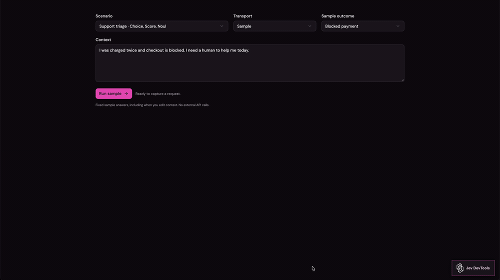

<div align="center">

# Jev DevTools

**Your Jev requests, made visual.**

A drop-in React inspector for TypeSafe Jev.<br />
Follow the context, explore each question, and see the answers come together.

[](https://www.npmjs.com/package/jev-devtools)
[](https://github.com/diegoag64/jev-devtools/actions/workflows/ci.yml)
[](#install-in-another-react-app)
[](docs/nextjs.md)
[](LICENSE)
[](#install-in-another-react-app)

[Demo](#see-it-in-motion) · [Quick start](#run-the-playground) · [Install](#install-in-another-react-app) · [Next.js](docs/nextjs.md) · [Contributing](CONTRIBUTING.md)

</div>

## See it in motion

[](docs/assets/jev-devtools-demo.mp4)

<p align="center">
  <a href="docs/assets/jev-devtools-demo.mp4"><strong>▶ Watch the full 28-second demo</strong></a><br />
  <sub>Recorded in the sample playground. The preview loops; the full video preserves the original resolution.</sub>
</p>

## Why Jev DevTools?

I got tired of drawing a new diagram for every Jev idea. This turns the requests your app already makes into something you can explore: one root component, a server adapter, and a drawer that follows along as you build.

Inspired by the TanStack Query DevTools workflow, built with a custom Jev drawer and the visual language of [Diagram Motion Lab](https://github.com/diegoag64/diagram-motion-lab). **TanStack is not a dependency.**

### A little less JSON archaeology

| | What you can inspect |
| --- | --- |
| **✦ Connected flows** | Animated connections between shared context, questions, and returned values. |
| **◈ Every Jev primitive** | Choice probability bars, Score values, Noul probabilities, and Box regions. |
| **⌕ Request history** | Search and filter calls, then open Flow, Questions, Context, Transport, or Raw. |
| **↻ Transport details** | Attempts, retries, errors, and cancellation alongside the logical request. |
| **⚛ React + Node** | One root component, scoped styles, and a server adapter. React 18/19 and Next.js App Router examples included. |

The diagrams visualize captured inputs and responses. They don't expose hidden model reasoning or infer your application's routing policies.

## How it fits together

```text
Your server calls Jev through the instrumented SDK client
                         │
                         ▼
              Bounded in-memory recorder
                         │
                  same-origin SSE
                         │
                         ▼
              <JevDevtools /> in React
             flows · questions · context
                  transport · raw
```

Only calls made through the instrumented client are recorded. Your API key stays on the server; capture and display are opt-in.

## Run the playground

Requires Node **22.12+** (24 recommended).

```sh
git clone https://github.com/diegoag64/jev-devtools.git
cd jev-devtools
npm ci
npm run dev
```

Open http://127.0.0.1:4182/. Sample mode needs no API key. Run a scenario to see its application result, then open **Jev DevTools** in the bottom-right corner to inspect the call. Samples cover Choice, Score, Noul, Box, retries, errors, and cancellation. Fixture responses do not change when you edit context.

For optional live mode, copy `apps/playground/.env.example` to `apps/playground/.env.local`, set `TYPESAFE_API_KEY`, and restart. Keys stay on the server. Live inference has not been verified during extraction.

## Install in another React app

**[Jev DevTools 0.1.0 is available on npm](https://www.npmjs.com/package/jev-devtools).** This is an experimental release; APIs may change before 1.0.

```sh
npm install jev-devtools
```

<details>
<summary>Developing locally? Install a packed checkout</summary>

To try local changes before a future release:

```sh
# In this repository:
npm ci
npm run pack:devtools

# In your React application:
npm install /absolute/path/to/jev-devtools/jev-devtools-0.1.0.tgz
```

</details>

Mount once near the root:

```tsx
import { JevDevtools } from 'jev-devtools';
import 'jev-devtools/styles.css';

export function Root() {
  return <>
    <App />
    <JevDevtools enabled={import.meta.env.DEV} defaultOpen={false} />
  </>;
}
```

On the Node server:

```ts
import { createJevDevtools } from 'jev-devtools/server';

const inspector = createJevDevtools({
  enabled: process.env.NODE_ENV === 'development',
  origin: 'http://localhost:3000',
});
const jev = inspector.createClient({ apiKey: process.env.TYPESAFE_API_KEY });
app.use(inspector.middleware); // At root, before fallback routes.
// Your handlers continue to call jev.systemOne(...).
// Call inspector.dispose() when shutting down the server.
```

Only calls through this client are recorded. Both routes and inspector must share the same adapter instance. History is bounded and in memory, and the browser connects over same-origin SSE. React 18/19 are peer dependencies. Tailwind, shadcn, and the playground are not bundled with the library.

See the [complete integration guide](docs/integration.md) for Next.js, proxies, custom endpoints, authorization, redaction, session scoping, and runtime limits. The adapter currently targets Node, not edge runtimes or distributed/serverless aggregation. Capture and display are both disabled by default.

Migrating from the extracted prototype? Replace `@diagram-motion-lab/jev-devtools` with `jev-devtools` in dependencies and imports, including `/server` and `/styles.css`. Component props and server APIs are unchanged. Restart the dev server after upgrading. See [0.1.0 release notes](CHANGELOG.md).

## Next.js and server frameworks

Next.js App Router has a [complete setup guide](docs/nextjs.md) and [sample app](examples/nextjs-app) covering Route Handlers, Server Actions, and Server Components. Use `getJevDevtools(appKey, optionsFactory)` on the server to retain a shared recorder across module reloads, and mount the same `<JevDevtools />` component in your root layout. No Next.js dependency is added to the package.

`handle(request)` supports Node frameworks with Web Request/Response; `middleware` supports Express/Connect. Histories remain local to one Node realm/process. Edge runtimes and distributed/serverless aggregation are not supported.

## Repository layout

| Path | Purpose |
| --- | --- |
| `packages/jev-devtools` | React drawer, diagrams, recorder, Node adapter, scoped CSS |
| `apps/playground` | Sample/live scenarios, minimal shadcn form, application previews |
| `examples/react-vite` | Independent consumer using only public package exports |
| `examples/nextjs-app` | Next.js App Router consumer using the packed package |
| `docs` | Integration, architecture, provenance, and release process |

The playground consumes built public exports, so restart `npm run dev` after library edits, or run `npm run build:package` separately. The static diagram lab and its `/docs/` replica remain in the original repo.

## Verify

```sh
npm run check
npm test
npm run build
npm run check:playground
npm run verify:package
npm run verify:nextjs
```

`verify:package` packs the library and installs it in a temporary independent React app, checks SSR/disabled behavior, and builds the consumer with a browser/server boundary check. Set `JEV_VERIFY_REACT=18.3.1` to verify React 18 instead of the default React 19. Registry access is allowed by default; `JEV_VERIFY_OFFLINE=1` is available when all dependencies are cached.

`check:playground` compiles the full interactive development UI into a temporary directory. The regular production build intentionally contains only a local-tool notice; it is not a hosted demo.

After `npm run pack:devtools`, you can also run `npm install && npm run dev` inside `examples/react-vite` (port 4183, sample-only).

Changes use feature branches and PRs by default. See [CONTRIBUTING.md](CONTRIBUTING.md), [architecture](docs/architecture.md), and [release instructions](docs/releases.md). No workflow publishes packages or deploys the playground.

## Credits & license

Built from [Diagram Motion Lab](https://github.com/diegoag64/diagram-motion-lab), with diagram styling rooted in [Cathryn Lavery's diagram-design](https://github.com/cathrynlavery/diagram-design). TypeSafe branding belongs to its respective owner.

MIT for project code; see [LICENSE](LICENSE) and [third-party notices](THIRD_PARTY_NOTICES.txt) for design provenance and branding.

<div align="center">

**Have a Jev flow you'd love to inspect?**<br />
[Open an issue](https://github.com/diegoag64/jev-devtools/issues) · [Contribute a PR](CONTRIBUTING.md)

</div>
